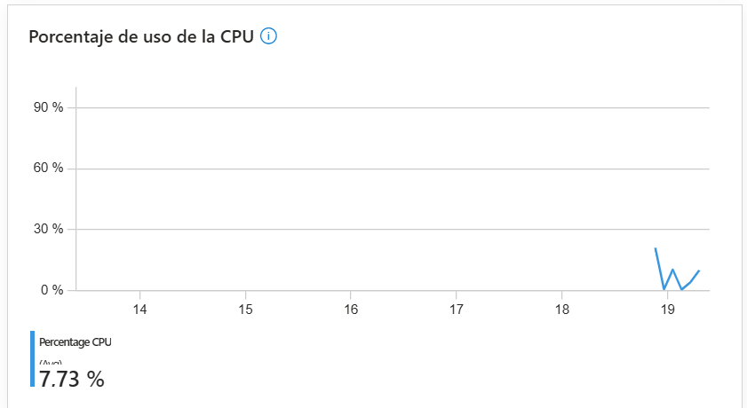
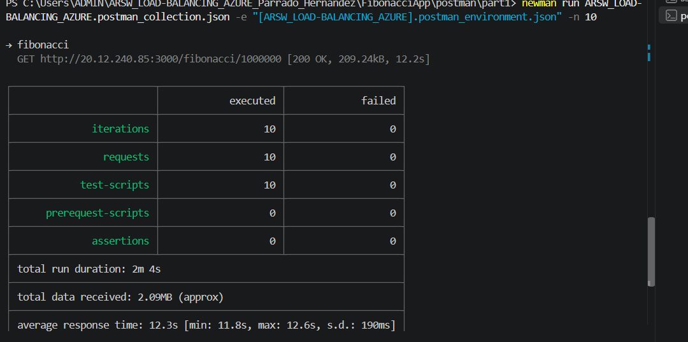
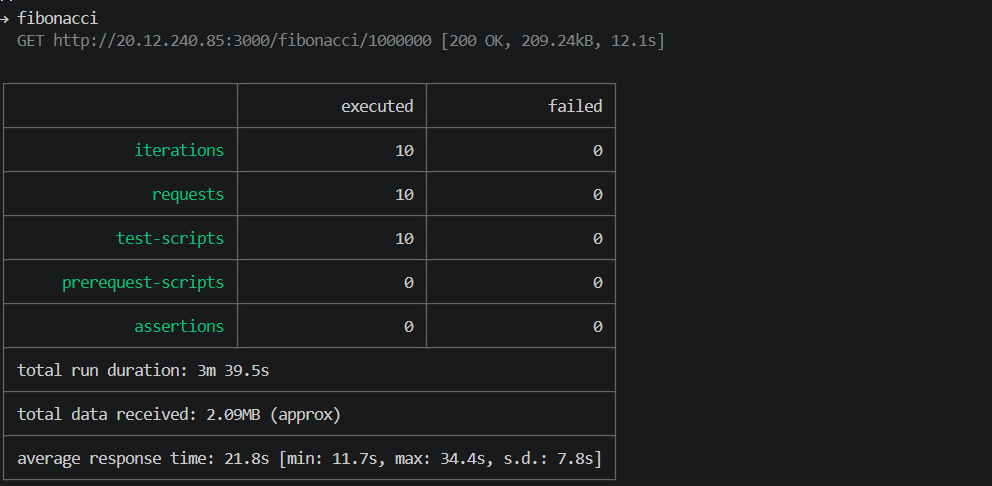

# Respuestas - Escalamiento en Azure
### Parrado - Hernandez

## Video
[](https://youtu.be/aTDD47IvrdU)

---

## Parte 1 - Escalabilidad Vertical

**Pregunta 1: ¿Cuántos y cuáles recursos crea Azure junto con la VM?**

Azure crea 6 recursos adicionales junto con la VM:
- Virtual Network (VNet)
- Network Interface (NIC)
- Network Security Group (NSG)
- Public IP Address
- OS Disk
- SSH Key

**Pregunta 2: ¿Brevemente describa para qué sirve cada recurso?**

- **Virtual Network:** Red privada virtual donde se comunican los recursos de Azure.
- **Network Interface:** Permite que la VM se conecte a la red.
- **Network Security Group:** Controla el tráfico de entrada y salida mediante reglas de seguridad.
- **Public IP Address:** Dirección IP pública para acceder a la VM desde internet.
- **OS Disk:** Disco de almacenamiento donde está instalado el sistema operativo.
- **SSH Key:** Par de claves para autenticación segura por SSH.

**Pregunta 3: ¿Al cerrar la conexión ssh con la VM, por qué se cae la aplicación? ¿Por qué debemos crear un Inbound port rule?**

Al cerrar la conexión SSH, el proceso hijo (node) que se ejecutó en esa sesión termina porque depende del proceso padre (la sesión SSH). Por eso se usa `forever`, que mantiene el proceso corriendo independientemente de la sesión SSH.

Se debe crear un Inbound port rule porque por defecto Azure bloquea todo el tráfico entrante excepto SSH (22). Sin la regla para el puerto 3000, el firewall de Azure bloquea las peticiones a la aplicación.

**Pregunta 4: Tabla de tiempos e interpretación**

| n | B2s (s) | D4s_v3 (s) |
|---|---|---|
| 1000000 | 11.71 | 9.15 |
| 1010000 | 12.27 | 9.15 |
| 1020000 | 12.48 | 9.35 |
| 1030000 | 13.14 | 9.72 |
| 1040000 | 13.23 | 9.77 |
| 1050000 | 13.63 | 9.99 |
| 1060000 | 13.70 | 10.04 |
| 1070000 | 14.12 | 10.33 |
| 1080000 | 14.40 | 10.53 |
| 1090000 | 14.24 | 10.72 |

La función tarda tanto porque es O(n) — realiza n iteraciones para calcular el resultado, sin ningún tipo de caché o memoización. Para n=1.000.000 hace un millón de operaciones aritméticas con números de precisión arbitraria (big-integer), lo que es computacionalmente costoso.

**Pregunta 5: Consumo de CPU**



La función consume alta CPU porque realiza millones de operaciones aritméticas de forma síncrona en un solo hilo de Node.js, bloqueando el event loop y saturando el procesador durante todo el tiempo de cálculo.

**Pregunta 6: Resumen ejecución Newman**




**Pregunta 7: Diferencia entre B2ms y B1ls**

| Característica | B1ls | B2ms |
|---|---|---|
| vCPUs | 1 | 2 |
| RAM | 0.5 GB | 8 GB |
| Almacenamiento temporal | 4 GB | 16 GB |
| Créditos CPU/hora | 6 | 24 |

La serie B son VMs "burstables" — acumulan créditos de CPU cuando están inactivas y los gastan cuando necesitan más rendimiento. B1ls es el tamaño más pequeño disponible. B2ms tiene 4x más créditos por hora, permitiendo sostener cargas más intensas por más tiempo.

**Pregunta 8: ¿Aumentar el tamaño de la VM es una buena solución?**

No es la mejor solución a largo plazo. Aumentar el tamaño mejora temporalmente el rendimiento pero no resuelve el problema de fondo (algoritmo sin caché). Además, cuando se cambia el tamaño de la VM, la aplicación se cae porque la VM se reinicia, causando downtime.

**Pregunta 9: ¿Qué pasa con la infraestructura cuando cambia el tamaño?**

La VM se detiene y reinicia, lo que implica:
- Downtime durante el redimensionamiento (2-5 minutos)
- La aplicación deja de responder
- Se pierde el estado de `forever` y hay que reiniciar la app manualmente
- La IP pública puede cambiar si no es estática

**Pregunta 10: ¿Hubo mejora en el consumo de CPU o tiempos de respuesta?**

Sí hubo mejora. Con la VM D4s_v3 los tiempos bajaron ~25% (de ~12s a ~9s en petición individual). Con 2 peticiones paralelas el tiempo promedio bajó de ~21s a ~17s. Sin embargo la mejora no es proporcional al costo adicional, porque el cuello de botella sigue siendo el algoritmo O(n) sin caché.

**Pregunta 11: ¿Con 4 ejecuciones paralelas el comportamiento es porcentualmente mejor?**

No, con 4 ejecuciones paralelas el sistema se satura más. La escalabilidad vertical tiene un límite — agregar más recursos a una sola máquina no escala linealmente cuando el algoritmo es ineficiente y Node.js es single-threaded.

---

## Parte 2 - Escalabilidad Horizontal

**¿Cuáles son los tipos de balanceadores de carga en Azure?**

Azure tiene dos tipos:
- **Public Load Balancer:** Distribuye tráfico de internet hacia las VMs. Necesita IP pública.
- **Internal Load Balancer:** Distribuye tráfico dentro de una red virtual privada.

**SKU (Stock Keeping Unit):** Define el nivel de servicio del balanceador:
- **Basic:** Gratuito, sin SLA, hasta 300 instancias, sin zonas de disponibilidad.
- **Standard:** De pago, SLA 99.99%, hasta 1000 instancias, soporta zonas de disponibilidad.

El balanceador necesita IP pública para ser el punto de entrada único desde internet hacia el conjunto de VMs del backend.

**¿Cuál es el propósito del Backend Pool?**

Es el conjunto de VMs que reciben el tráfico distribuido por el balanceador. Define qué instancias están disponibles para responder peticiones.

**¿Cuál es el propósito del Health Probe?**

Verifica periódicamente que las VMs del backend están activas y respondiendo. Si una VM falla la prueba, el balanceador deja de enviarle tráfico hasta que se recupere.

**¿Cuál es el propósito de la Load Balancing Rule?**

Define cómo se distribuye el tráfico: qué puerto del frontend se mapea a qué puerto del backend, y el algoritmo de distribución.

Tipos de sesión persistente:
- **None:** Cada petición puede ir a cualquier VM (mejor distribución).
- **Client IP:** Peticiones del mismo cliente siempre van a la misma VM.
- **Client IP and Protocol:** Igual que el anterior pero también considera el protocolo.

La persistencia de sesión afecta la escalabilidad porque si se usa, una VM puede sobrecargarse mientras otras están ociosas.

**¿Qué es una Virtual Network? ¿Qué es una Subnet?**

- **Virtual Network (VNet):** Red privada aislada en Azure donde los recursos se comunican de forma segura.
- **Subnet:** Segmento dentro de la VNet que agrupa recursos con reglas de seguridad comunes.
- **Address space:** Rango total de IPs disponibles para la VNet (ej: 10.0.0.0/16).
- **Address range:** Subconjunto del address space asignado a una subnet (ej: 10.0.0.0/24).

**¿Qué son las Availability Zones?**

Son ubicaciones físicas separadas dentro de una región de Azure, cada una con su propio suministro eléctrico, red y refrigeración. Seleccionamos 3 zonas diferentes para garantizar alta disponibilidad — si una zona falla, las otras dos siguen funcionando.

Una IP **zone-redundant** significa que la IP pública está disponible en múltiples zonas, por lo que sobrevive a la falla de una zona.

**¿Cuál es el propósito del Network Security Group?**

Actúa como firewall virtual que controla el tráfico de entrada y salida de los recursos de Azure mediante reglas de seguridad basadas en puerto, protocolo y dirección IP.

**Informe de Newman - Comparativo Parte 1 vs Parte 2**

<!-- Pega aquí la captura del resultado de Newman Parte 2 -->

| Métrica | 1 VM (Vertical) | 3 VMs (Horizontal) |
|---|---|---|
| Peticiones exitosas | ? | ? |
| Tiempo promedio | ? | ? |
| Fallos | ? | ? |

**Diagrama de Despliegue**

```
Internet
    |
[Public IP - Load Balancer]
    |
[Azure Load Balancer Standard]
    |
[Backend Pool]
   /|\
  / | \
VM1 VM2 VM3  (Zonas 1, 2, 3)
[FibonacciApp:3000]
```
